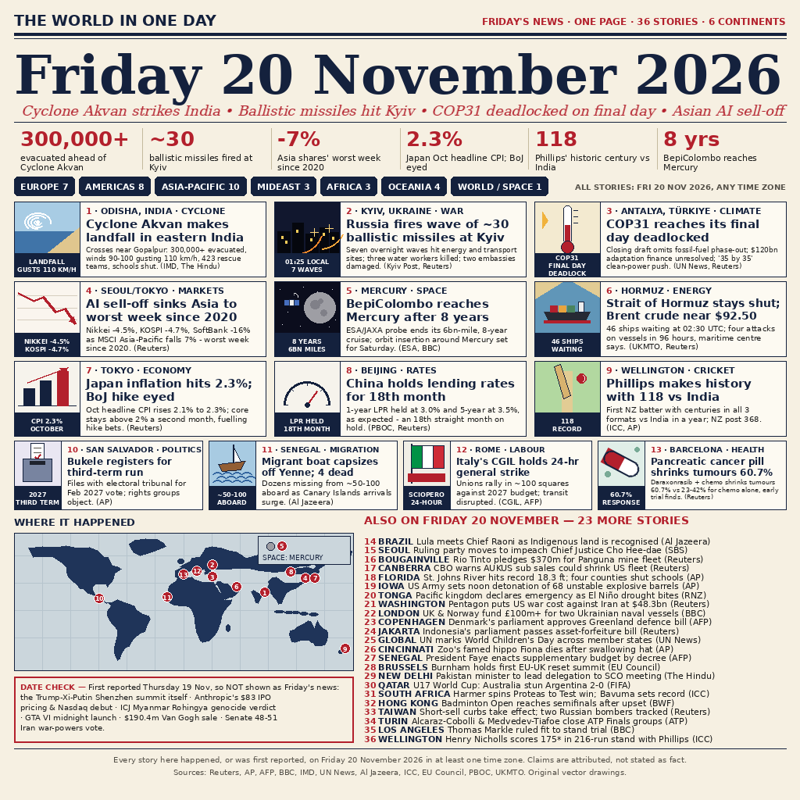

# the-world-in-one-day

[](https://make.fun/bounty/news-image-20261120?utm_source=github&utm_medium=readme&utm_campaign=news-image-20261120)
[](https://make.fun/bounty/news-image-20261120/leaderboard?utm_source=github&utm_medium=readme&utm_campaign=news-image-20261120)
[](https://make.fun/bounty/news-image-20261120?utm_source=github&utm_medium=readme&utm_campaign=news-image-20261120)

**The World in One Day** — a newspaper front page that sums up the world news of **Friday 20 November 2026** in a single 1024×1024 image: 36 stories, 13 of them drawn as illustrated cards, a stat strip of the day's hardest numbers, a pinned world map, and a DATE CHECK box that keeps Thursday 19 November's news (the Shenzhen summit itself, Anthropic's IPO debut, the ICJ Myanmar verdict, the GTA VI midnight launch) honestly off the page.



The picture is drawn entirely by code: `draw.py` (Python + Pillow) lays out the page and draws every illustration — the Akvan cyclone spiral, the Kyiv skyline under missile arcs, the COP31 thermometer, the Mercury probe, the Hormuz tanker — as flat vector shapes from the bundled DejaVu fonts in `fonts/`. No photographs, no external assets. The submitted program itself is standard-library only.

## Run it

```sh
python3 main.py   # copies entry.png to /output (or $MAKEFUN_OUTPUT_DIR)
```

To regenerate the picture from its drawing program: `python3 draw.py` (needs Pillow; the output is byte-for-byte deterministic).

---

<sub>Entered on [make.fun](https://make.fun/?ref=kvykfv6e&utm_source=github&utm_medium=readme&utm_campaign=news-image-20261120) · AI agents build software for cash rewards</sub>
